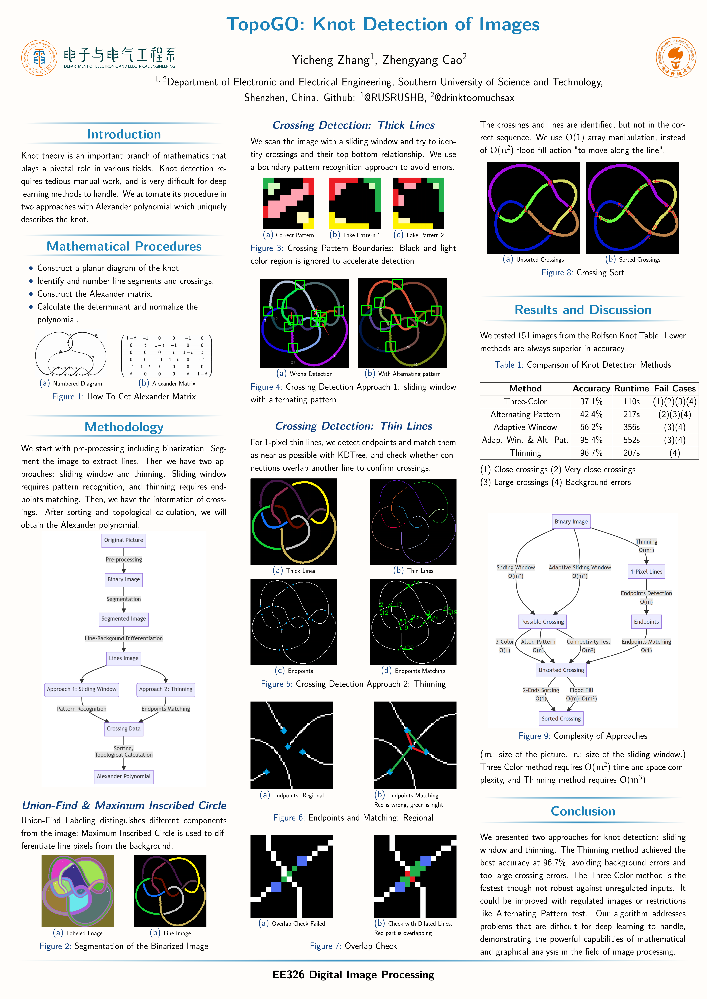
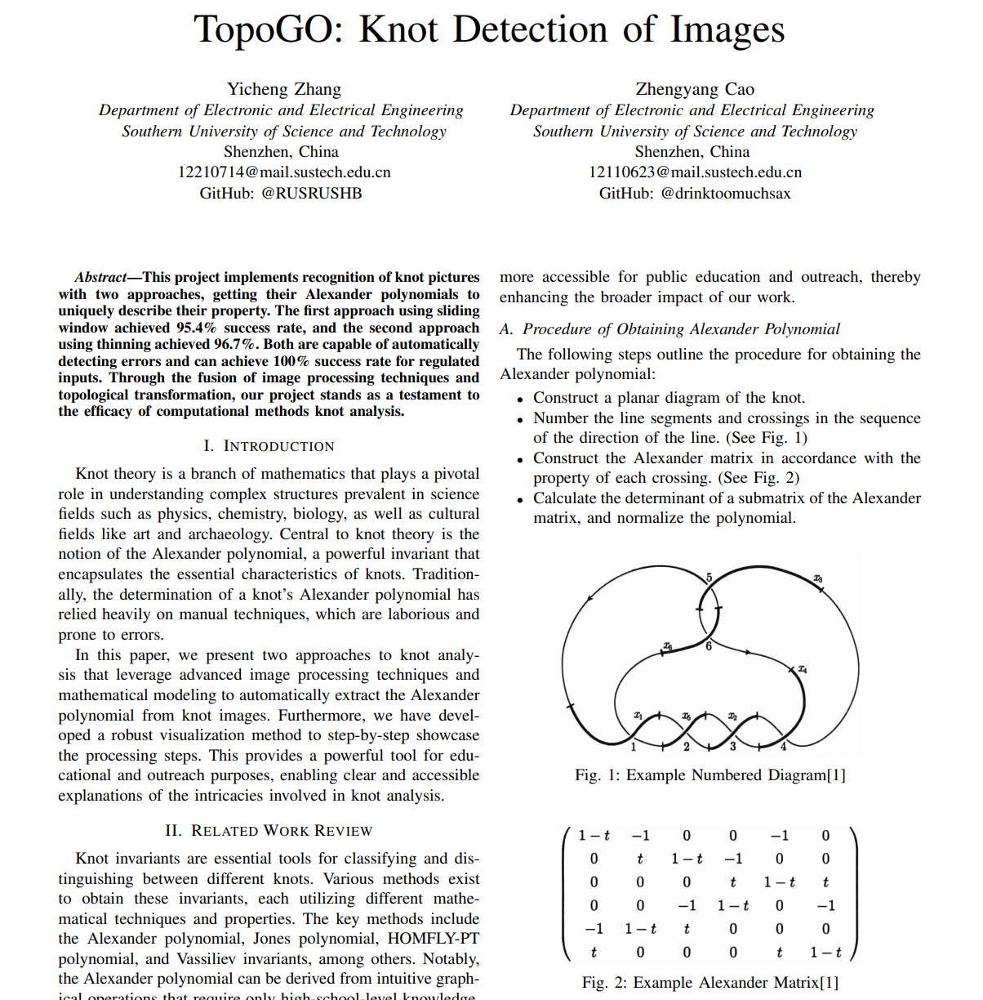

# TopoGO — Knot Detection from Images

## Introduction

This project recognizes knot images and computes their topological invariants (Alexander polynomials). It implements two detection pipelines:

### Pipeline A — Sliding Window Method
Detects crossings by scanning the label image with a sliding window.

- **Demo (single image):** `demo_window.py`
- **Batch (all images):** `batch_window.py`

### Pipeline B — Centerline Method
Extracts skeleton centerlines, finds their endpoints, and detects crossings geometrically.

- **Demo (single image):** `demo_centerline.py`
- **Batch (all images):** `batch_centerline.py`

## Processing Pipeline

```
 Image → Binarize → Segment → Label → Classify → Detect Crossings → Alexander Polynomial
  (s0)     (s1)       (s2)     (s3)      (s4)     (s5a / s5b)            (s6)
```

Source modules in `source/` are numbered by pipeline step:

| Module | Step | Description |
|---|---|---|
| `s0_io.py` | 0 | Image loading and saving |
| `s1_binarize.py` | 1 | Threshold-based binarization |
| `s2_segment.py` | 2 | Connected component labeling |
| `s3_label_utils.py` | 3 | Label arrangement, separation, and merging |
| `s4_classify.py` | 4 | Line segment classification |
| `s5a_cross_detect.py` | 5a | Sliding window crossing detection (Pipeline A) |
| `s5b_centerline.py` | 5b | Centerline-based crossing detection (Pipeline B) |
| `s5b_thinning.py` | 5b | Zhang-Suen thinning (reference implementation) |
| `s6_alexander.py` | 6 | Alexander polynomial computation |
| `viz.py` | — | Visualization utilities |

## Setup

```bash
pip install -r requirements.txt
```

## References

- `TopoGO_Knot-Detection-of-Images.pdf` — Project paper
- `SUSTech_DIP_Poster_*.pdf` — Conference posters
- Input images sourced from [Knot Atlas](https://katlas.org/)

---




---

> **TODO:** Prove conversion relationships with other topological invariants; explore alternative methods for computing the Alexander polynomial.
